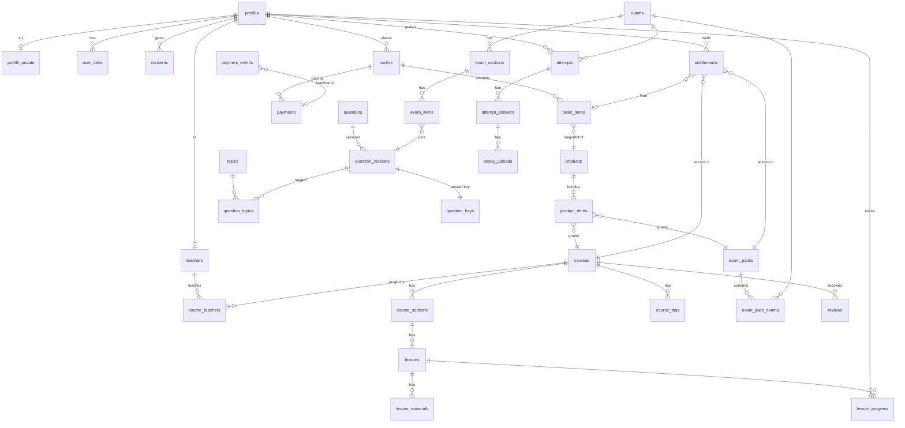

# DATABASE — Lớp Học Thực Lực

> Phiên bản 2.0 · 25/11/2026 · PostgreSQL (Supabase, vùng Singapore) · Đi kèm PRD.md
> Tài liệu thiết kế, chưa phải migration. Tên kiểu dữ liệu theo PostgreSQL.

## 1. Nguyên tắc

1. **Bật RLS cho mọi bảng.** Bảng không có policy thì không ai ngoài máy chủ đọc được.
2. **Tiền là số nguyên VNĐ** (`bigint`), không dùng số thực.
3. **Khóa chính `uuid`** (sinh theo thời gian, UUIDv7) cho bảng nghiệp vụ; `slug` duy nhất cho URL.
4. **Nội dung chấm điểm bất biến:** câu hỏi có phiên bản; đề và bài làm trỏ tới phiên bản cụ thể.
5. **Đơn hàng chụp lại giá và tên** tại thời điểm mua.
6. **Mọi bảng có `created_at`, `updated_at`**; bảng nghiệp vụ quan trọng xóa mềm (`deleted_at`).
7. **Có cột `subject`** ở khóa học, câu hỏi, đề (mặc định `math`) để mở môn khác mà không đổi cấu trúc.
8. **Dữ liệu cá nhân nhạy cảm tách bảng riêng** (`profile_private`) để giới hạn quyền đọc.

## 2. Sơ đồ quan hệ (ERD)

## 3. Bảng theo nhóm

### 3.1 Người dùng và quyền

**`profiles`** — hồ sơ công khai tối thiểu, 1–1 với `auth.users`

| Cột | Kiểu | Ghi chú |
|---|---|---|
| id | uuid PK | = `auth.users.id` |
| full_name | text | |
| grade | smallint | 6–12, null nếu không phải học sinh |
| school, province | text | |
| avatar_url | text | |
| status | enum `active`/`locked` | admin khóa tài khoản |
| created_at, updated_at | timestamptz | |

**`profile_private`** — dữ liệu liên lạc, chỉ chủ tài khoản và admin đọc

| Cột | Kiểu | Ghi chú |
|---|---|---|
| user_id | uuid PK FK profiles | |
| phone | text | |
| date_of_birth | date | để xác định cần phụ huynh đồng ý |
| guardian_name, guardian_email, guardian_phone | text | |

**`user_roles`** — một người có thể nhiều vai trò

| Cột | Kiểu | Ghi chú |
|---|---|---|
| user_id | uuid FK | |
| role | enum `student`/`teacher`/`admin` | |
| PK | (user_id, role) | |

Vai trò được đưa vào JWT bằng **Custom Access Token Hook** của Supabase, nên policy RLS đọc vai trò từ token, không cần join bảng ở mỗi truy vấn.

**`consents`** — bản ghi đồng ý xử lý dữ liệu

| Cột | Kiểu | Ghi chú |
|---|---|---|
| id | uuid PK | |
| user_id | uuid FK | |
| kind | enum `data_processing`/`marketing`/`guardian` | |
| policy_version | text | phiên bản chính sách tại lúc đồng ý |
| granted_by | enum `self`/`guardian` | |
| guardian_email | text | khi `granted_by = guardian` |
| granted_at, revoked_at | timestamptz | |

**`teachers`** — hồ sơ giảng dạy công khai: `id`, `profile_id` (unique), `slug`, `display_name`, `bio_md`, `credentials`, `photo_key`, `is_public`.

### 3.2 Nội dung học

**`courses`**

| Cột | Kiểu | Ghi chú |
|---|---|---|
| id | uuid PK | |
| subject | text | mặc định `math` |
| slug | text unique | |
| title, short_desc | text | |
| description_md, outcomes_md, audience_md, roadmap_md | text | Markdown + LaTeX |
| grade_min, grade_max | smallint | khóa ôn thi có thể trải nhiều lớp |
| goal | enum `foundation`/`grade10_entrance`/`gifted`/`national_exam`/`aptitude` | |
| format | enum `video`/`live`/`hybrid` | |
| cover_key, intro_video_id | text | R2 key, Bunny video id |
| access_days | int | null = vĩnh viễn |
| status | enum `draft`/`published`/`archived` | |
| published_at | timestamptz | |

Số bài học và số bài kiểm tra **không lưu cứng** mà tính bằng view có cache, để không bị lệch.

**`course_teachers`** (course_id, teacher_id, is_primary) — một khóa nhiều giáo viên.

**`course_sections`** — `id`, `course_id`, `title`, `position`.

**`lessons`**

| Cột | Kiểu | Ghi chú |
|---|---|---|
| id | uuid PK | |
| course_id, section_id | uuid FK | `course_id` lặp lại để policy RLS kiểm tra nhanh |
| position | int | |
| title | text | |
| video_id | text | Bunny Stream |
| duration_sec | int | |
| content_md | text | lý thuyết |
| practice_exam_id | uuid FK exams | bài tập sau bài |
| is_preview | bool | học thử |
| status | enum | |

**`lesson_materials`** — `id`, `lesson_id`, `title`, `file_key` (R2), `mime`, `bytes`.

**`course_faqs`**, **`reviews`** (`user_id`, `course_id`, `rating` 1–5, `body`, `status` `pending`/`approved`/`rejected`; unique (user_id, course_id); chỉ tạo được khi có quyền truy cập khóa).

### 3.3 Bán hàng

**`products`** — thứ được bán

| Cột | Kiểu | Ghi chú |
|---|---|---|
| id | uuid PK | |
| slug | text unique | |
| kind | enum `course`/`bundle`/`exam_pack`/`renewal` | |
| title | text | |
| list_price, sale_price | bigint | VNĐ |
| sale_starts_at, sale_ends_at | timestamptz | |
| is_active | bool | |

**`product_items`** — sản phẩm cấp quyền gì: `product_id`, `course_id` hoặc `exam_pack_id` (đúng một trong hai), `access_days` (ghi đè thời hạn của khóa nếu có).

**`exam_packs`** — gói luyện đề: `id`, `slug`, `title`, `description_md`; **`exam_pack_exams`** (pack_id, exam_id, position).

**`coupons`**

| Cột | Kiểu | Ghi chú |
|---|---|---|
| code | text unique | lưu chữ hoa |
| kind | enum `percent`/`amount` | |
| value | bigint | |
| max_discount | bigint | trần cho loại % |
| max_uses, max_uses_per_user | int | |
| applies_to_product_ids | uuid[] | null = mọi sản phẩm |
| starts_at, ends_at | timestamptz | |

**`orders`**

| Cột | Kiểu | Ghi chú |
|---|---|---|
| id | uuid PK | |
| code | text unique | ngắn, dễ gõ khi chuyển khoản, ví dụ `LTL8K2Q9` |
| user_id | uuid FK | |
| status | enum `pending`/`paid`/`expired`/`cancelled`/`refunded`/`partially_refunded` | |
| subtotal, discount, total | bigint | chốt khi tạo đơn |
| coupon_id | uuid FK | |
| buyer_name, buyer_email, buyer_phone | text | chụp lại |
| expires_at, paid_at | timestamptz | |

**`order_items`** — `order_id`, `product_id`, `title_snapshot`, `unit_price`, `quantity` (luôn 1 ở MVP).

**`payments`** — một khoản tiền đã xác minh gắn với đơn

| Cột | Kiểu | Ghi chú |
|---|---|---|
| id | uuid PK | |
| order_id | uuid FK | |
| provider | enum `sepay`/`vnpay`/`manual` | |
| provider_txn_id | text | **unique cùng provider** |
| amount | bigint | |
| received_at, verified_at | timestamptz | |
| verified_by | uuid | null = tự động; có giá trị = admin đối soát |

**`payment_events`** — nhật ký thô mọi webhook, kể cả không khớp

| Cột | Kiểu | Ghi chú |
|---|---|---|
| id | uuid PK | |
| provider | enum | |
| provider_txn_id | text | |
| raw | jsonb | payload gốc |
| signature_ok | bool | |
| match_status | enum `matched`/`no_code`/`amount_mismatch`/`duplicate`/`order_not_pending`/`resolved` | |
| payment_id | uuid FK null | |
| received_at | timestamptz | |

Admin xử lý các dòng không phải `matched` ở màn hình Đối soát.

**`entitlements`** — quyền truy cập thực tế (thay `enrollments` của bản 1.0)

| Cột | Kiểu | Ghi chú |
|---|---|---|
| id | uuid PK | |
| user_id | uuid FK | |
| course_id / exam_pack_id | uuid FK | đúng một trong hai |
| source | enum `order`/`activation_code`/`admin`/`free` | |
| order_item_id | uuid FK null | để thu hồi khi hoàn tiền |
| starts_at, expires_at | timestamptz | `expires_at` null = vĩnh viễn |
| revoked_at | timestamptz | |

Mua lại / gia hạn tạo dòng mới hoặc kéo dài `expires_at`; hàm `has_access(user, course)` gom tất cả dòng còn hiệu lực.

**`activation_codes`** (P2) — `code_hash`, `product_id`, `batch`, `redeemed_by`, `redeemed_at`, `expires_at`.

### 3.4 Học tập

**`lesson_progress`** — PK (user_id, lesson_id); `last_position_sec`, `watched_sec`, `completed_at`, `updated_at`. Trình phát gửi nhịp 30–60 s một lần, không gửi mỗi giây.

**`study_daily`** — PK (user_id, day); `seconds`. Cộng dồn theo ngày thay vì lưu từng phiên, đủ cho "thời gian học".

**`announcements`** — thông báo chung: `id`, `audience` (`all`/`course`/`user`), `course_id`, `user_id`, `title`, `body`, `published_at`. **`announcement_reads`** (announcement_id, user_id, read_at). Gửi cho 1 khóa có 3.000 học sinh chỉ tạo 1 dòng.

### 3.5 Ngân hàng câu hỏi và đề

**`chapters`** — `id`, `subject`, `grade`, `title`, `position`. **`topics`** — `id`, `chapter_id`, `title`, `slug`.

**`questions`** — danh tính câu hỏi: `id`, `subject`, `type` (`mcq`/`true_false`/`short_answer`/`essay`), `current_version_id`, `created_by`, `status`.

**`question_versions`** — **bất biến**, mỗi lần sửa tạo dòng mới

| Cột | Kiểu | Ghi chú |
|---|---|---|
| id | uuid PK | |
| question_id | uuid FK | |
| version | int | |
| stem_md | text | đề bài Markdown + LaTeX |
| options | jsonb | MCQ: `[{key:"A", md:"…"}]`; Đúng/Sai: `[{key:"a", md:"…"}, …×4]` |
| figure_keys | text[] | ảnh SVG/PNG trên R2 |
| solution_md | text | lời giải |
| difficulty | smallint | 1 nhận biết · 2 thông hiểu · 3 vận dụng · 4 vận dụng cao |
| grade | smallint | |
| source_note | text | nguồn đề (tự soạn / đề thi năm …) |
| created_by, created_at | | |

**`question_keys`** — đáp án, **không policy SELECT cho học sinh**

| Cột | Kiểu | Ghi chú |
|---|---|---|
| version_id | uuid PK FK | |
| answer | jsonb | MCQ `"B"` · Đúng/Sai `{"a":true,"b":false,"c":true,"d":true}` · Trả lời ngắn `["-0,5","-1/2"]` · Tự luận null |
| rubric | jsonb | tự luận: `[{part:"a", max:0.5, guide_md:"…"}]` |

**`question_topics`** — (version_id, topic_id): một câu nhiều chuyên đề.

**`exams`**

| Cột | Kiểu | Ghi chú |
|---|---|---|
| id | uuid PK | |
| subject, slug, title | text | |
| kind | enum `practice`/`lesson_quiz`/`midterm`/`final`/`mock`/`national`/`aptitude`/`placement` | |
| grade | smallint | |
| duration_min | int | |
| shuffle_items, shuffle_options | bool | |
| is_free | bool | |
| max_attempts | int | null = không giới hạn |
| show_solution | enum `after_submit`/`after_close`/`never` | |
| opens_at, closes_at | timestamptz | cho đợt thi thử |
| status, published_version | | đề xuất bản thì khóa nội dung |

**`exam_sections`** — `id`, `exam_id`, `position`, `title` (Phần I…), `scoring` jsonb:
- MCQ: `{"type":"per_item","points":0.25}`
- Đúng/Sai: `{"type":"tf_ladder","ladder":[0,0.1,0.25,0.5,1]}` (số ý đúng 0–4)
- Trả lời ngắn: `{"type":"per_item","points":0.5}`
- Tự luận: `{"type":"rubric"}`

**`exam_items`** — `id`, `section_id`, `position`, `question_version_id` (**ghim phiên bản**), `points_override`.

**`attempts`**

| Cột | Kiểu | Ghi chú |
|---|---|---|
| id | uuid PK | |
| user_id, exam_id | uuid FK | |
| exam_published_version | int | |
| item_order, option_order | jsonb | thứ tự đã đảo cho riêng lượt này |
| started_at, deadline_at | timestamptz | đồng hồ tính theo `deadline_at` |
| draft_answers | jsonb | **tự lưu ghi vào đây**: 1 dòng / lượt, không ghi 22 dòng mỗi lần |
| draft_rev | int | chống ghi đè ngược khi mạng chập chờn |
| submitted_at | timestamptz | |
| submit_reason | enum `manual`/`timeout`/`admin` | |
| status | enum `in_progress`/`submitted`/`grading`/`graded` | |
| auto_score, manual_score, total_score | numeric(5,2) | |
| focus_lost_count | int | số lần rời tab |

**`attempt_answers`** — tạo một lần khi nộp, phục vụ chấm và thống kê

| Cột | Kiểu | Ghi chú |
|---|---|---|
| attempt_id, exam_item_id | PK | |
| question_version_id | uuid | |
| answer | jsonb | |
| correct_parts | smallint | Đúng/Sai: số ý đúng |
| is_correct | bool | |
| score | numeric(4,2) | |
| graded_by | uuid | null = tự động |
| feedback_md | text | |
| graded_at | timestamptz | |

**`essay_uploads`** — `id`, `attempt_id`, `exam_item_id`, `file_key`, `page`, `width`, `height`, `annotated_key` (P2).

**`topic_mastery`** (view vật chất hóa, làm mới sau mỗi lần chấm) — (user_id, topic_id): số câu đã làm, tỷ lệ đúng có trọng số mức độ. Dưới 5 câu → "chưa đủ dữ liệu".

### 3.6 Vận hành

- **`site_content`** (P2) — `key`, `value` jsonb, `updated_by`.
- **`contact_messages`** — `name`, `email`, `phone`, `message`, `status`.
- **`data_requests`** — yêu cầu tải về / xóa dữ liệu: `user_id`, `kind`, `status`, `handled_by`, `handled_at`.
- **`audit_logs`** — **chỉ ghi thêm**: `id` bigint identity, `actor_id`, `action`, `entity`, `entity_id`, `before` jsonb, `after` jsonb, `ip`, `user_agent`, `at`. Không có policy UPDATE/DELETE cho bất kỳ ai; ghi bằng trigger trên các bảng quản trị.
- **`rate_limits`** — đếm theo (key, cửa sổ thời gian) cho đăng nhập, quên mật khẩu, tạo đơn, nộp liên hệ.

## 4. Phân quyền (RLS)

| Bảng | Khách | Học sinh | Giáo viên | Admin |
|---|---|---|---|---|
| courses, sections, lessons (metadata) | Đọc bản `published` | Như khách | + đọc/sửa khóa được phân công | Toàn quyền |
| lessons.content_md, video, tài liệu | Chỉ `is_preview` | Khi `has_access()` | Khóa được phân công | Toàn quyền |
| products, coupons | Đọc sản phẩm đang bán (không đọc coupons) | Như khách | — | Toàn quyền |
| profiles | — | Đọc / sửa của mình | Đọc học sinh trong khóa phân công | Toàn quyền |
| profile_private, consents | — | Của mình | — | Đọc |
| orders, order_items, payments | — | Đọc của mình; **không sửa trạng thái** | — | Toàn quyền |
| payment_events | — | — | — | Đọc, đánh dấu đã xử lý |
| entitlements | — | Đọc của mình | Đọc trong khóa phân công | Toàn quyền (ghi nhật ký) |
| question_versions | Câu trong đề công khai **sau khi** xem lời giải được phép | Câu trong đề đang làm (không kèm đáp án) | Đọc / tạo | Toàn quyền |
| question_keys | — | — | Đọc / tạo | Toàn quyền |
| attempts, attempt_answers | — | Của mình; không sửa điểm | Bài trong khóa / đề phân công; sửa điểm tự luận | Toàn quyền |
| audit_logs | — | — | — | Chỉ đọc |

Quy tắc thực thi:
- Tạo đơn, chấm điểm, cấp quyền, xử lý webhook chạy trong **hàm database `SECURITY DEFINER`** hoặc máy chủ với khóa dịch vụ; học sinh không có quyền INSERT trực tiếp vào `entitlements`, `payments`, `attempt_answers`.
- Policy viết `(select auth.uid())` thay vì `auth.uid()` và đánh index các cột dùng trong policy, để Postgres không tính lại cho từng dòng.
- Mỗi policy có test pgTAP: một tài khoản học sinh A cố đọc dữ liệu của B phải nhận 0 dòng.

## 5. Index

| Bảng | Index | Phục vụ |
|---|---|---|
| courses | (status, goal, grade_min), unique(slug), GIN full-text `unaccent(title)` | Danh mục, tìm kiếm không dấu |
| lessons | (course_id, position), (section_id, position) | Mục lục |
| entitlements | (user_id, course_id) where revoked_at is null | `has_access()` — truy vấn nóng nhất |
| lesson_progress | PK (user_id, lesson_id) | Tiến độ |
| question_versions | (question_id, version) | |
| question_topics | (topic_id) | Luyện theo chuyên đề |
| exam_items | (section_id, position) | |
| attempts | (user_id, exam_id, started_at desc), (status, deadline_at) | Lịch sử; cron tự nộp |
| attempt_answers | (question_version_id) | Thống kê câu hỏi |
| orders | unique(code), (user_id, created_at desc), (status, expires_at) | |
| payments | unique(provider, provider_txn_id) | Chống ghi nhận trùng |
| payment_events | (match_status) where match_status <> 'matched' | Màn hình đối soát |
| audit_logs | (entity, entity_id), (actor_id, at desc) | |

## 6. Ước lượng dung lượng ở 5.000 học sinh

| Bảng | Giả định | Số dòng |
|---|---|---|
| lesson_progress | 5.000 × 150 bài | ~750.000 |
| study_daily | 5.000 × 200 ngày | ~1.000.000 |
| attempts | 5.000 × 60 lượt | ~300.000 |
| attempt_answers | 300.000 × 25 câu | ~7.500.000 |
| question_versions | 20.000 câu × 1,5 phiên bản | ~30.000 |

Tổng dưới vài GB, nằm trong 8 GB disk của Supabase Pro. Postgres xử lý tốt hàng chục triệu dòng với index đúng; **chưa cần** partition, sharding hay read replica. Nếu `attempt_answers` vượt khoảng 50 triệu dòng, partition theo tháng của `graded_at`.

## 7. Luồng ghi quan trọng

**Xác nhận thanh toán (một transaction):**
1. Ghi `payment_events` (luôn luôn, kể cả khi lỗi).
2. Kiểm tra chữ ký → tìm mã đơn trong nội dung chuyển khoản → khóa dòng đơn (`SELECT … FOR UPDATE`).
3. Đơn `pending`, chưa hết hạn, số tiền = `total` → tạo `payments` (unique chặn trùng) → đơn `paid` → tạo `entitlements` cho từng `product_items` → ghi `audit_logs`.
4. Sai bất kỳ điều kiện nào → `match_status` tương ứng, không cấp quyền, báo admin.

**Nộp bài:**
1. Khóa dòng `attempts`; từ chối nếu đã nộp.
2. Lấy câu trả lời từ `draft_answers` (hoặc payload nộp nếu `draft_rev` mới hơn) → tạo `attempt_answers` một lần → chấm theo `exam_sections.scoring` và `question_keys` → cập nhật điểm.
3. Có câu tự luận → `status = grading`, vào hàng chờ giáo viên; không có → `graded`.
4. Cron mỗi phút tự nộp các lượt quá `deadline_at` + 2 phút ân hạn.

## 8. Sao lưu và phục hồi

| Lớp | Cách làm | Giữ |
|---|---|---|
| 1 | Sao lưu hằng ngày có sẵn của Supabase Pro | 7 ngày |
| 2 | `pg_dump` mã hóa hằng đêm (GitHub Actions) → Cloudflare R2, bucket riêng chỉ ghi | 30 ngày + bản đầu mỗi tháng giữ 12 tháng |
| 3 | Video gốc và file gốc giữ một bản trên R2 | Vĩnh viễn |
| 4 | Point-in-Time Recovery | Bật khi doanh thu đủ bù chi phí |

Mục tiêu: mất tối đa 24 giờ dữ liệu (RPO), khôi phục trong 4 giờ (RTO). Thử khôi phục vào database tạm mỗi tháng, ghi lại thời gian thực tế.

## 9. Lưu giữ và xóa dữ liệu

| Dữ liệu | Thời gian giữ | Khi học sinh yêu cầu xóa |
|---|---|---|
| Hồ sơ, liên lạc | Đến khi xóa tài khoản | Xóa / ẩn danh |
| Bài làm, tiến độ | Đến khi xóa tài khoản | Ẩn danh (giữ số liệu thống kê câu hỏi) |
| Đơn hàng, thanh toán | Theo luật kế toán (chờ luật sư xác nhận thời hạn) | Giữ, chỉ ẩn thông tin không bắt buộc |
| Nhật ký quản trị | 2 năm (đề xuất) | Giữ |
| payment_events.raw | 2 năm (đề xuất), sau đó xóa trường cá nhân | Giữ phần kế toán |

## 10. Thay đổi so với bản 1.0

| Bản 1.0 | Bản 2.0 | Lý do |
|---|---|---|
| `profiles.role` một giá trị | `user_roles` nhiều giá trị + đưa vào JWT | Admin cũng có thể là giáo viên; policy nhanh hơn |
| `courses` có giá | `products` + `product_items` | Combo, gói đề, gia hạn |
| `courses.teacher_id` | `course_teachers` | Nhiều giáo viên / khóa |
| `enrollments` | `entitlements` có nguồn và liên kết đơn | Thu hồi khi hoàn tiền, gói đề dùng chung cơ chế |
| `questions` sửa trực tiếp | `question_versions` bất biến | Không làm sai điểm cũ |
| Không có cấu hình chấm | `exam_sections.scoring` | Chấm Đúng/Sai theo bậc thang |
| Tự lưu ghi `attempt_answers` | Tự lưu ghi `attempts.draft_answers` | Giảm ~20 lần số dòng ghi khi 1.000 người cùng làm bài |
| `payments` duy nhất | + `payment_events` | Không mất giao dịch sai nội dung |
| `study_sessions` theo phiên | `study_daily` cộng dồn | Ít dòng, đủ cho báo cáo |
| `notifications` mỗi người một dòng | `announcements` + `announcement_reads` | Gửi cả khóa không tạo hàng nghìn dòng |
| Không có | `consents`, `profile_private`, `data_requests` | Luật Bảo vệ dữ liệu cá nhân |
| Không có | cột `subject` | Mở rộng môn khác |
