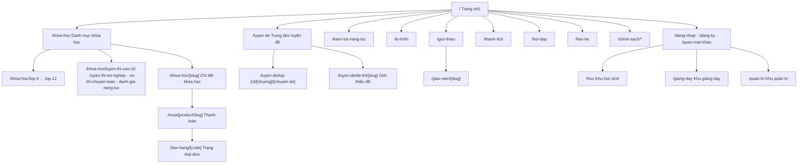
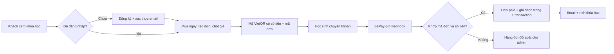
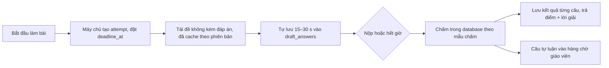

# SITEMAP — Lớp Học Thực Lực

> Phiên bản 2.0 · 25/11/2026 · Đi kèm PRD.md

Website có 4 khu vực: **Công khai** (cho Google và khách), **Học sinh** (`/hoc`), **Giảng dạy** (`/giang-day`) và **Quản trị** (`/quan-tri`). URL công khai viết tiếng Việt không dấu. Ba khu vực sau không được index.

## 1. Sơ đồ tổng quan

## 2. Khu công khai

Cột **Render**: SSG = dựng sẵn khi build · ISR = dựng sẵn, làm mới khi admin sửa · SSR = dựng theo từng request · CSR = chạy trên trình duyệt.

| URL | Trang | Render | Index | Ghi chú |
|---|---|---|---|---|
| `/` | Trang chủ | ISR | Có | 10 khối theo prototype |
| `/khoa-hoc` | Danh mục khóa học | ISR + lọc phía trình duyệt | Có | Tham số `?lop=&muc-tieu=&hinh-thuc=&sap-xep=&trang=`; trang có tham số đặt canonical về `/khoa-hoc` |
| `/khoa-hoc/lop-9` … `/khoa-hoc/lop-12` | Danh mục theo lớp | ISR | Có | Trang đích SEO |
| `/khoa-hoc/luyen-thi-vao-10` | Theo mục tiêu | ISR | Có | |
| `/khoa-hoc/luyen-thi-tot-nghiep` | Theo mục tiêu | ISR | Có | |
| `/khoa-hoc/on-thi-chuyen-toan` | Theo mục tiêu | ISR | Có | |
| `/khoa-hoc/danh-gia-nang-luc` | HSA, TSA, SPT, V-ACT, BCA | ISR | Có | P2 khi có khóa |
| `/khoa-hoc/[slug]` | Chi tiết khóa học | ISR | Có | Structured data `Course`, `FAQPage` |
| `/luyen-de` | Trung tâm luyện đề | ISR | Có | |
| `/luyen-de/lop-[n]` · `/[chuong]` · `/[chuyen-de]` | Luyện theo lớp / chương / chuyên đề | ISR | Có | Chỉ hiện đề đã xuất bản |
| `/luyen-de/de-thi/[slug]` | Giới thiệu một đề | ISR | Có | Nút "Làm bài" → đăng nhập |
| `/kiem-tra-nang-luc` | Bài kiểm tra đầu vào miễn phí | SSR | Có | Làm bài cần đăng nhập (để lưu kết quả) |
| `/lo-trinh` | Lộ trình theo mục tiêu | SSG | Có | |
| `/gioi-thieu` | Triết lý, đội ngũ | SSG | Có | |
| `/giao-vien/[slug]` | Hồ sơ giáo viên | ISR | Có | Structured data `Person` |
| `/thanh-tich` | Kết quả học sinh | ISR | Có khi có dữ liệu | Không có dữ liệu → `noindex` |
| `/hoi-dap` | FAQ | SSG | Có | `FAQPage` |
| `/lien-he` | Liên hệ | SSG + Server Action | Có | CAPTCHA |
| `/chinh-sach/bao-mat` · `/dieu-khoan` · `/thanh-toan` · `/hoan-tien` | Chính sách | SSG | Có | |
| `/mua/[productSlug]` | Thanh toán (Mua ngay) | SSR | Không | Cần đăng nhập + email đã xác thực |
| `/don-hang/[code]` | Trạng thái đơn, mã QR | SSR + hỏi trạng thái 3 s/lần | Không | Chỉ chủ đơn xem được |
| `/dang-nhap` · `/dang-ky` · `/quen-mat-khau` · `/dat-lai-mat-khau` · `/xac-thuc-email` · `/dong-y-phu-huynh/[token]` | Xác thực | SSR | Không | |
| `/sitemap.xml` · `/robots.txt` | SEO | Sinh tự động | — | Sitemap chỉ chứa URL index được |

Đã bỏ so với bản 1.0: `/gio-hang` (thay bằng Mua ngay).

## 3. Khu học sinh `/hoc` (cần đăng nhập)

| URL | Trang | Ưu tiên |
|---|---|---|
| `/hoc` | Dashboard: khóa của tôi, bài đang dở, điểm gần đây, thời gian học, thông báo | P1 |
| `/hoc/khoa-hoc/[slug]` | Mục lục khóa đã mua, tiến độ từng chương | P1 |
| `/hoc/khoa-hoc/[slug]/bai/[lessonId]` | Trang bài học: video, PDF, lý thuyết, bài tập, hoàn thành | P1 |
| `/hoc/luyen-de` | Đề đã mua / miễn phí, đề đang làm dở | P1 |
| `/hoc/lam-bai/[attemptId]` | Phòng làm bài (toàn màn hình, không header) | P1 |
| `/hoc/ket-qua/[attemptId]` | Điểm, lời giải, thống kê theo phần / chuyên đề | P1 |
| `/hoc/ket-qua` | Lịch sử làm bài, điểm mạnh / yếu | P1 |
| `/hoc/tai-lieu` | Tài liệu của các khóa | P1 |
| `/hoc/thong-bao` | Thông báo | P1 |
| `/hoc/tai-khoan` | Hồ sơ, phụ huynh, đổi mật khẩu, phiên đăng nhập | P1 |
| `/hoc/tai-khoan/don-hang` | Lịch sử thanh toán, biên nhận | P1 |
| `/hoc/tai-khoan/du-lieu` | Tải về / yêu cầu xóa dữ liệu | P1 |
| `/hoc/kich-hoat` | Nhập mã kích hoạt | P2 |

## 4. Khu giảng dạy `/giang-day` (vai trò giáo viên)

Nếu ra mắt với ≤ 3 giáo viên, các trang này nằm trong `/quan-tri` và lọc theo quyền.

| URL | Trang | Ưu tiên |
|---|---|---|
| `/giang-day` | Tổng quan: bài chờ chấm, khóa phụ trách | P1 |
| `/giang-day/khoa-hoc` · `/[id]` | Soạn chương, bài học | P1 |
| `/giang-day/cau-hoi` · `/moi` · `/[id]` | Ngân hàng câu hỏi, trình soạn có xem trước | P1 |
| `/giang-day/cau-hoi/nhap` | Nhập hàng loạt từ LaTeX / Word | P1 hoặc P2 |
| `/giang-day/de-thi` · `/[id]` | Soạn đề theo phần, chọn mẫu chấm | P1 |
| `/giang-day/cham-bai` · `/[attemptId]` | Hàng chờ chấm tự luận | P1 |
| `/giang-day/hoc-sinh` | Kết quả học sinh trong khóa phụ trách | P1 |

## 5. Khu quản trị `/quan-tri` (vai trò quản trị, bắt buộc 2FA)

| Nhóm | URL | Ưu tiên |
|---|---|---|
| Tổng quan | `/quan-tri` (doanh thu, học sinh mới, hoạt động, đối soát chờ xử lý) | P1 |
| Người dùng | `/quan-tri/hoc-sinh` · `/[id]` · `/quan-tri/giao-vien` · `/quan-tri/yeu-cau-du-lieu` | P1 |
| Nội dung học | `/quan-tri/khoa-hoc` · `/bai-hoc` · `/video` · `/cau-hoi` · `/de-thi` · `/bai-lam` · `/ket-qua` | P1 |
| Kinh doanh | `/quan-tri/san-pham` · `/don-hang` · `/giao-dich` · `/doi-soat` · `/ma-giam-gia` | P1 |
| Kinh doanh | `/quan-tri/ma-kich-hoat` · `/hoan-tien` · `/bao-cao` | P2 |
| Website | `/quan-tri/noi-dung` (banner, FAQ, đánh giá, thành tích) | P2 |
| Hệ thống | `/quan-tri/cau-hinh` (thanh toán, email, analytics — trạng thái kết nối) · `/quan-tri/nhat-ky` | P1 |

## 6. Endpoint máy chủ (không phải trang)

| Đường dẫn | Mục đích | Bảo vệ |
|---|---|---|
| `/api/webhooks/sepay` | Nhận báo tiền vào | Khóa bí mật trong header, chỉ POST, idempotent |
| `/api/webhooks/vnpay-ipn` | IPN của VNPay (P2) | Kiểm tra `vnp_SecureHash` |
| `/api/webhooks/bunny` | Video mã hóa xong | Khóa bí mật |
| `/api/media/video-token` | Cấp link video ký số | Đăng nhập + ghi danh còn hạn |
| `/api/media/file-url` | Cấp link PDF / ảnh ký số | Đăng nhập + quyền |
| `/api/attempts/[id]/save` | Tự lưu bài làm | Chủ bài làm + còn hạn |
| `/api/cron/*` | Hết hạn đơn, tự nộp bài quá giờ, dọn dẹp | Khóa cron |

## 7. Luồng chính

